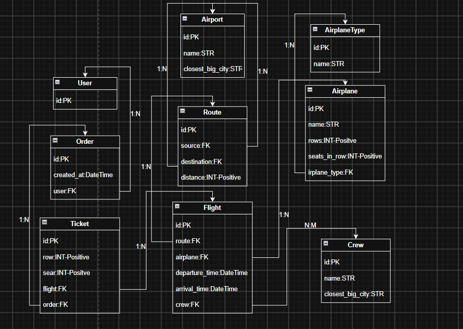

# Airport API

Django REST Framework API for airports, routes, airplanes, flights, tickets and orders.

---
## DB diagram


---
## Authentication

The API uses JWT authentication.

---
### Login

`POST /api/users/login/`

```json
{
  "email": "user@example.com",
  "password": "StrongPass123!"
}
```

Use the returned access token in the header:

```
Authorization: Bearer <access_token>
```

Refresh an access token:

`POST /api/users/login/refresh/`

```json
{
  "refresh": "<refresh_token>"
}
```

Access tokens live for 1 day and refresh tokens live for 2 days.

---
## Permissions

Airports, routes, crew, airplane types, airplanes and flights can be viewed publicly.

Only staff users can create, update or delete those resources.

Users can register publicly. The users endpoint is admin-only after registration.

Orders require authentication:
- regular users see only their own orders;
- admins see all orders;
- regular users can create orders, but cannot update or delete them;
- admins can update or delete orders.

Tickets are read-only through the API. Tickets are created together with an order.

---
## Tickets and baggage

Each ticket has a `baggage_type` field:
- `1` — Light
- `2` — Medium
- `3` — Heavy

The API stores the baggage category only; baggage weight is not a separate ticket field.

Example order with two tickets:

```json
{
  "tickets": [
    {
      "row": 1,
      "seat": 1,
      "flight": 1,
      "baggage_type": 1
    },
    {
      "row": 1,
      "seat": 2,
      "flight": 1,
      "baggage_type": 3
    }
  ]
}
```

The API validates the flight departure time, row and seat limits, seat availability, duplicate seats inside one order, and the minimum of one ticket per order. Tickets can be listed only by authenticated users, and regular users see only tickets belonging to their own orders. Staff users can see all tickets.

---
## Flights

Filter by route:

`GET /api/flights/?route=1`

Filter by airplane:

`GET /api/flights/?airplane=1`

Filter by airports:

`GET /api/flights/?source=1&destination=2`

Filter by departure date:

`GET /api/flights/?departure_date=2026-10-01`

Search by airport, city, airplane or airplane type:

`GET /api/flights/?search=Warsaw`

Order results:

`GET /api/flights/?ordering=departure_time`

Pagination:

`GET /api/flights/?page=2&page_size=20`

Available seats for a flight:

`GET /api/flights/1/available-seats/`

---
## API documentation

Swagger UI:

`GET /api/docs/`

OpenAPI schema:

`GET /api/schema/`

---
## Run with Docker

Docker Compose uses SQLite; no PostgreSQL service is required.

Build the image and start the API:

```bash
docker compose up --build
```

The API will be available at `http://localhost:8000/`. Migrations run automatically when the container starts. The project directory is mounted into the container, so code changes and the SQLite database file remain on your machine.

Stop the container:

```bash
docker compose down
```

## Run locally

Set environment variables before starting Django. Use a private random `SECRET_KEY` outside development; the built-in development fallback is enabled only when `DEBUG=True`.

Linux/macOS example:

```bash
export DEBUG=True
export SECRET_KEY="local-development-only-change-me"
```

Install dependencies:

```bash
pip install -r requirements.txt
```

Apply migrations:

```bash
python manage.py migrate
```

Run the server:

```bash
python manage.py runserver
```

Run tests:

```bash
python manage.py test
```
